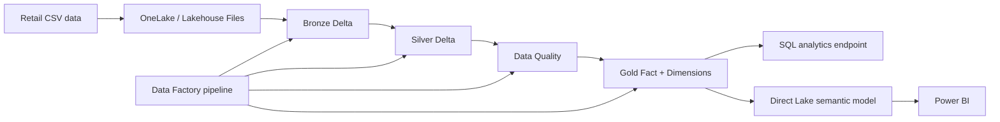

<<<<<<< HEAD
# Microsoft Fabric Retail Analytics

A GitHub-ready end-to-end Microsoft Fabric portfolio project using **OneLake, Lakehouse, Delta tables, PySpark, Data Factory pipelines, SQL analytics, Direct Lake and Power BI**.

## Scenario
A retail company needs an analytics platform for customer, product and sales data. Raw CSV files are ingested into a Fabric Lakehouse, transformed through Bronze/Silver/Gold layers, validated, and served to Power BI.

## Architecture



## Fabric capabilities demonstrated
- OneLake
- Lakehouse
- Delta tables
- Apache Spark / PySpark notebooks
- Data Factory pipelines
- SQL analytics endpoint
- Direct Lake
- Power BI
- GitHub source control
- Dev/Test/Prod CI/CD design

## Repository structure

```text
data/raw/                 Synthetic source CSVs
notebooks/                Four Fabric PySpark notebooks
pipeline/                 End-to-end pipeline design
sql/                      Analytics queries
powerbi/                  DAX measures and report design
devops/                   GitHub/Fabric setup
docs/                     Architecture and interview notes
```

## Run the project

### 1. Create a Fabric workspace and Lakehouse
Create a Lakehouse called:

`RetailLakehouse`

### 2. Upload sample data
Upload these files to `Files/raw/`:
- `customers.csv`
- `products.csv`
- `sales.csv`

### 3. Import the notebooks
Attach `RetailLakehouse` as the default Lakehouse and run:

1. `01_bronze_ingestion.ipynb`
2. `02_silver_transformation.ipynb`
3. `03_data_quality_checks.ipynb`
4. `04_gold_business_model.ipynb`

### 4. Create the pipeline
Use `pipeline/PL_Retail_End_to_End.md`.

Flow:

`Bronze -> Silver -> Data Quality -> Gold`

### 5. Validate with SQL
Run `sql/analytics_queries.sql` from the Lakehouse SQL analytics endpoint.

### 6. Build Power BI
Create a Direct Lake semantic model from:
- `gold_dim_customer`
- `gold_dim_product`
- `gold_fact_sales`

Use `powerbi/measures.dax` for KPI measures.

## Data-quality rules
- Unique customer IDs
- Unique product IDs
- Unique order IDs
- Non-null order dates
- Non-negative sales
- No orphan customer keys
- No orphan product keys

## Gold data model
- `gold_dim_customer`
- `gold_dim_product`
- `gold_fact_sales`
- `gold_sales_summary`

## Business KPIs
- Total Sales
- Gross Profit
- Gross Margin %
- Total Orders
- Units Sold
- Average Order Value
- Product/category performance
- Regional performance

## Production improvements
A production version should add:
- Incremental/watermark loading
- Environment parameters
- Identity/secrets management
- Audit/control tables
- Retry and alert policies
- Table optimization for scale
- RLS/OLS/CLS as required
- Dev/Test/Prod workspaces
- Automated validation and deployment

## Interview summary
> Built an end-to-end retail analytics platform in Microsoft Fabric using OneLake and Lakehouse. Implemented Bronze, Silver and Gold Delta layers using PySpark, added data-quality validation, orchestrated the workflow with Fabric Data Factory, queried the Gold layer through the SQL analytics endpoint, and designed a Direct Lake semantic model for Power BI. Version-controlled the solution through GitHub and documented a Dev/Test/Prod deployment approach.

## Resume bullets
- Built an end-to-end Microsoft Fabric analytics solution using OneLake, Lakehouse, PySpark, Data Factory, SQL analytics and Power BI.
- Implemented Bronze, Silver and Gold medallion layers with Delta tables, cleansing, deduplication and data-quality validation.
- Designed Gold fact/dimension tables and Direct Lake reporting for sales, margin, regional and product analytics.
- Documented Git-based source control and Dev/Test/Prod deployment practices for Fabric workloads.

## Data
All included source data is synthetic and safe for a public GitHub portfolio repository.
=======
# microsoft-fabric-retail-analytics
End-to-end Microsoft Fabric retail analytics project using OneLake, Lakehouse, PySpark, Data Factory, Medallion Architecture, Delta Lake, SQL Analytics, Direct Lake, Power BI, data quality checks, and GitHub-based CI/CD.
>>>>>>> 899b48e022bf73f26a7e512d8be3e77f392b7424
