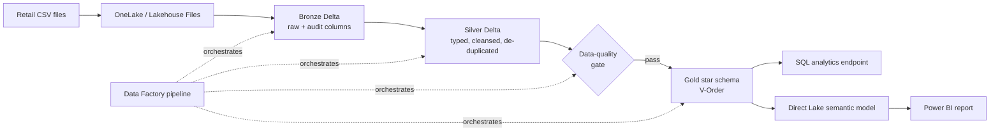
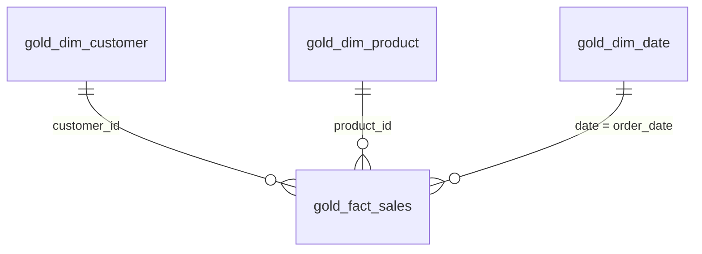

# Microsoft Fabric Retail Analytics

An end-to-end retail analytics solution on **Microsoft Fabric**: raw CSV data lands in OneLake, is processed through a **Bronze → Silver → Gold medallion architecture** with PySpark notebooks, validated by automated data-quality checks, orchestrated by a Fabric Data Factory pipeline, and served to **Power BI through a Direct Lake semantic model**.

   

## Business scenario

A retail company sells Technology, Furniture and Office Supplies products to Consumer, Corporate and Home Office customers across four regions. It needs one trusted platform for sales, margin, product and regional reporting instead of spreadsheets built from raw exports.

## Architecture



| Layer | Purpose | Tables |
|---|---|---|
| **Bronze** | Faithful copy of the source (all columns as strings) plus `_ingested_at` and `_source_file` audit columns | `bronze_customers`, `bronze_products`, `bronze_sales` |
| **Silver** | Explicit data types, trimmed/standardized text, null business keys removed, de-duplicated, invalid sales rejected | `silver_customers`, `silver_products`, `silver_sales` |
| **Gold** | Star schema for analytics, written with V-Order for fast Direct Lake reads | `gold_dim_customer`, `gold_dim_product`, `gold_dim_date`, `gold_fact_sales`, `gold_sales_summary` |

## Tech stack

Microsoft Fabric · OneLake · Lakehouse · Delta Lake · Apache Spark / PySpark · Fabric Data Factory · SQL analytics endpoint · Direct Lake · Power BI (DAX) · Git

## Repository structure

```text
data/raw/          Synthetic source data (120 customers, 30 products, 2,200 orders)
notebooks/         Four Fabric PySpark notebooks (Bronze, Silver, Data Quality, Gold)
pipeline/          Data Factory pipeline design
sql/               Analytics queries for the SQL analytics endpoint
powerbi/           DAX measures and report design
devops/            Git integration and branching approach
docs/              Architecture and project walkthrough
```

## How to run it

1. **Create a workspace and Lakehouse** — in a Fabric-enabled workspace, create a Lakehouse named `RetailLakehouse`.
2. **Upload the sample data** — upload `customers.csv`, `products.csv` and `sales.csv` from `data/raw/` to `Files/raw/` in the Lakehouse.
3. **Import the notebooks** — import the four notebooks from `notebooks/`, attach `RetailLakehouse` as the default Lakehouse, and run them in order:
   1. `01_bronze_ingestion`
   2. `02_silver_transformation`
   3. `03_data_quality_checks`
   4. `04_gold_business_model`
4. **Create the pipeline** — build `PL_Retail_End_to_End` as described in [`pipeline/PL_Retail_End_to_End.md`](pipeline/PL_Retail_End_to_End.md) so each notebook runs only when the previous one succeeds.
5. **Query with SQL** — run [`sql/analytics_queries.sql`](sql/analytics_queries.sql) against the Lakehouse SQL analytics endpoint.
6. **Build the report** — create a Direct Lake semantic model from the five Gold tables, set up the relationships in [`powerbi/report_design.md`](powerbi/report_design.md), mark `gold_dim_date` as the date table, and add the measures from [`powerbi/measures.dax`](powerbi/measures.dax).

## Data-quality gate

`03_data_quality_checks` fails the pipeline before Gold is rebuilt if any rule is broken:

- Unique `customer_id`, `product_id` and `order_id`
- No null `order_date`, `customer_id` or `product_id` on sales
- Quantity greater than zero, non-negative `sales_amount`
- Discount between 0 and 1
- `sales_amount` reconciles to `quantity × unit_price × (1 − discount)` within one cent
- No orphan customer or product keys in sales

Silver also prints a Bronze-to-Silver row-count reconciliation so rejected or duplicate rows are visible on every run.

## Gold data model



`gold_sales_summary` is a pre-aggregated daily table (by region, segment and category) for fast KPI queries.

## Business KPIs

Total Sales · Total Cost · Gross Profit · Gross Margin % · Total Orders · Units Sold · Average Order Value · Average Selling Price · Sales YTD · Sales Prior Year · Sales YoY %

## Performance and design choices

- **Strings in Bronze, types in Silver** — avoids `inferSchema` scanning every file twice and guarantees Bronze matches the source exactly.
- **`_metadata.file_path`** for lineage instead of the deprecated `input_file_name()`.
- **V-Order on Gold tables** — Fabric turns V-Order off by default in new workspaces; enabling it on the read-heavy Gold layer speeds up Direct Lake and the SQL analytics endpoint.
- **Single-pass data-quality aggregation** — completeness and validity rules are evaluated in one scan of the sales table.
- **Date dimension** — enables time intelligence (YTD, prior year, YoY) in Power BI.

## Production roadmap

Incremental/watermark loading instead of full overwrite · pipeline parameters per environment · audit/control table with run ID and row counts · retry and failure alerts · scheduled `OPTIMIZE` and `VACUUM` · RLS/OLS in the semantic model · Development/Test/Production workspaces promoted with Fabric deployment pipelines.

## Data

All data in this repository is synthetic and safe for public use.

## Author

**Someswara Rao K V** — Microsoft Fabric & Azure Data Engineer · [Portfolio](https://someshbvrm.github.io) · [LinkedIn](https://www.linkedin.com/in/someshkv)

## License

[MIT](LICENSE)
