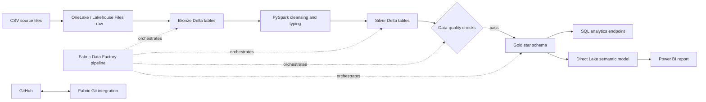

# Architecture

## Design
**Bronze:** raw-source representation (all columns as strings) plus `_ingested_at` and `_source_file` ingestion metadata.  
**Silver:** explicit data types, text cleansing and standardization, removal of null business keys, de-duplication and rejection of invalid sales rows.  
**Gold:** star schema — `gold_dim_customer`, `gold_dim_product`, `gold_dim_date` and `gold_fact_sales` — plus the pre-aggregated `gold_sales_summary`, written with V-Order for fast reads.

The same OneLake-backed Delta data is used by Spark, SQL and Power BI without separate copies for each engine.
