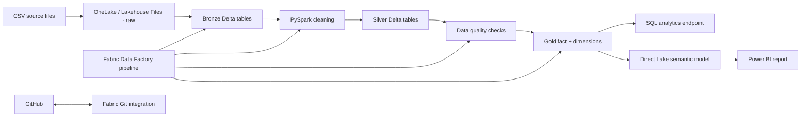

# Architecture

## Design
**Bronze:** raw-source representation plus ingestion metadata.  
**Silver:** data cleansing, type standardization, deduplication and validation.  
**Gold:** star-schema-style fact/dimension tables for business analytics.

The same OneLake-backed Delta data can be used by Spark, SQL and Power BI without maintaining separate copies for each engine.
